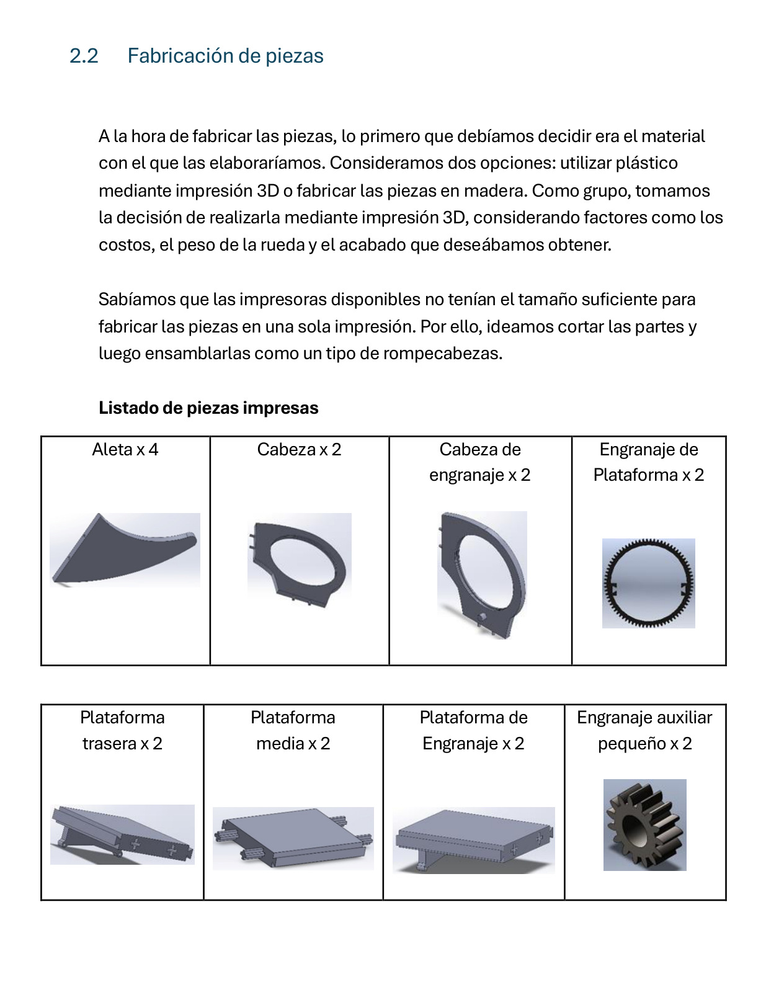
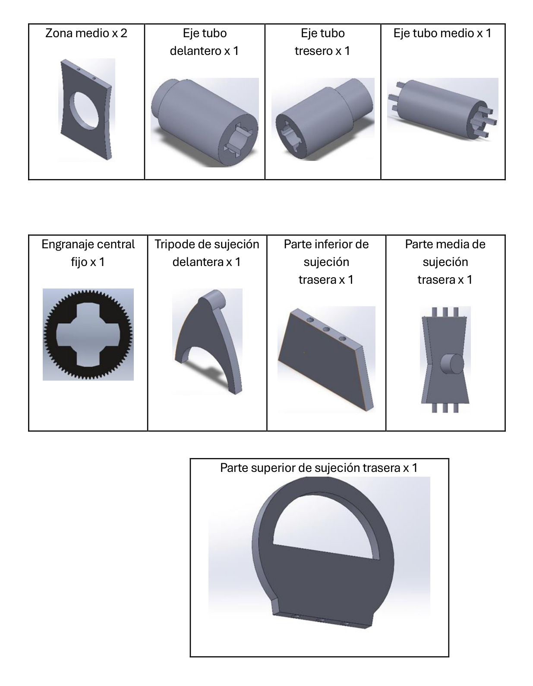
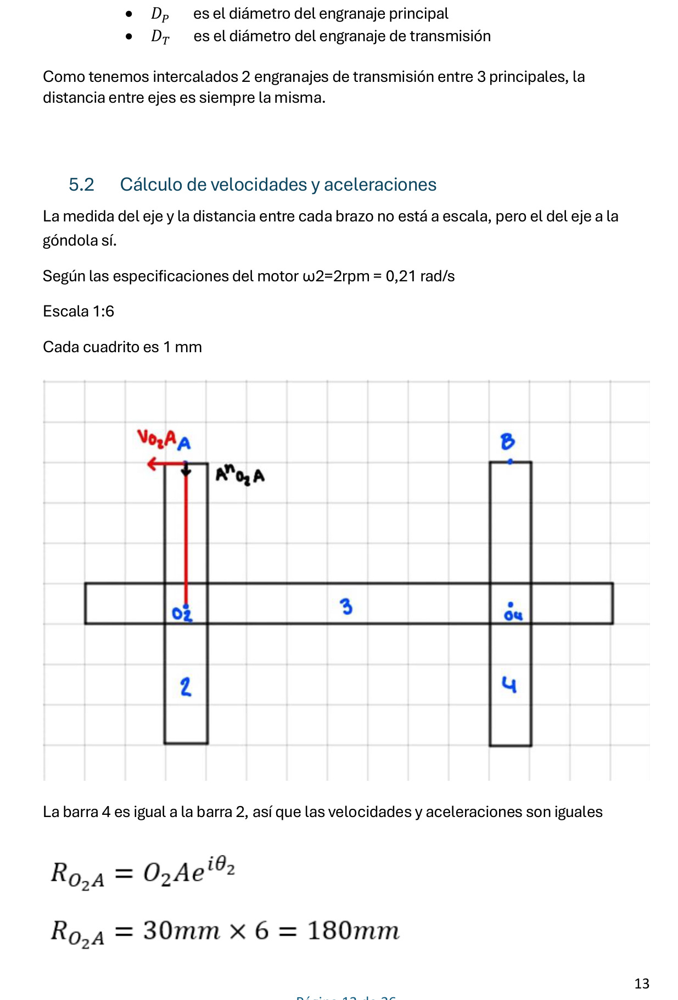
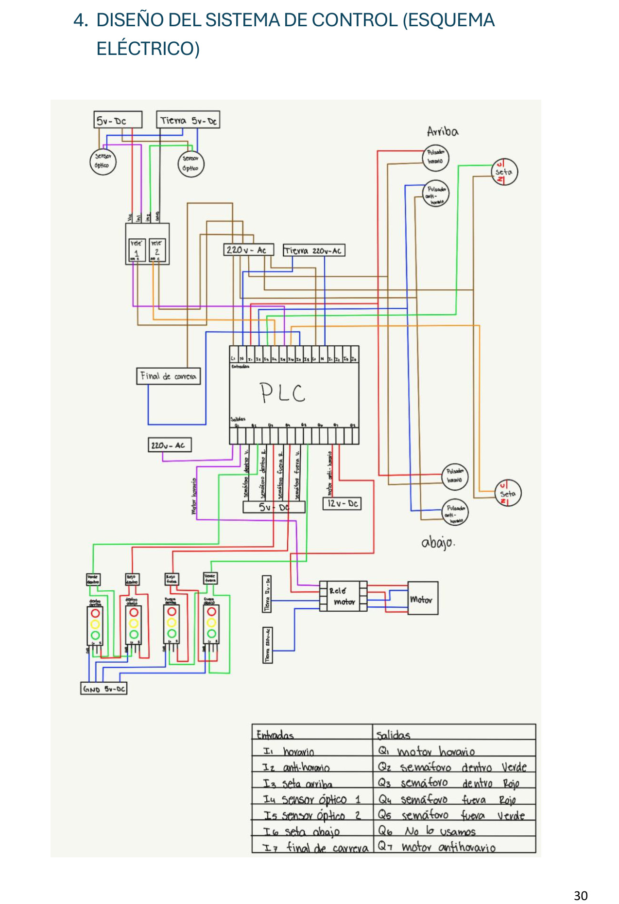
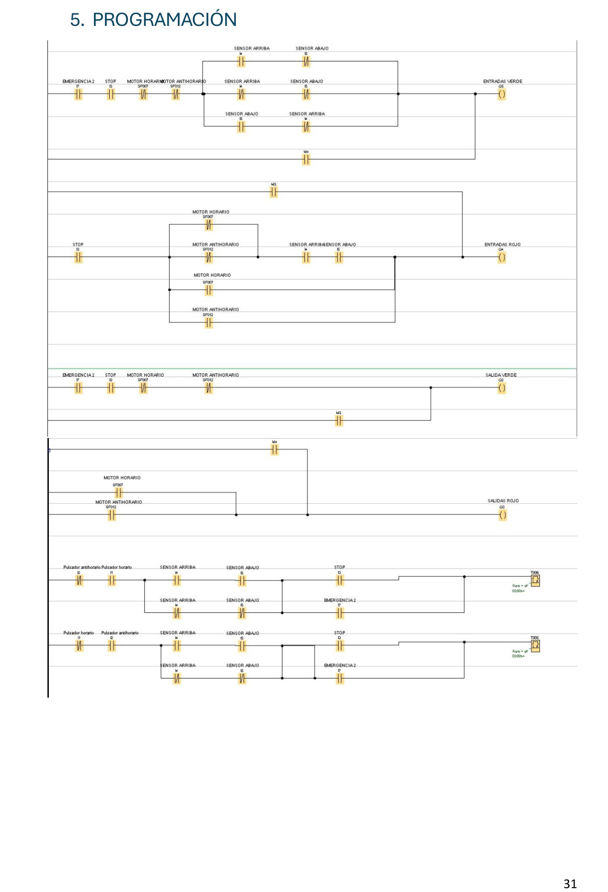
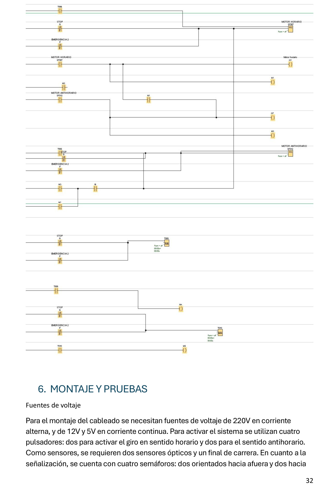

# Falkirk Wheel-Inspired Automated Scale Prototype

**Academic Engineering Project | Universidad Europea de Madrid | 2024–2025**

## Project Overview

Design, manufacturing and automation of a scale model inspired by the Falkirk Wheel, adapted to demonstrate the concept of transporting road vehicles between two different elevations.

The project was developed as part of two engineering courses:

- Theory of Machines and Mechanisms
- Automation and Control

The work combined mechanical design, 3D printing, gear transmission, kinematic analysis, PLC programming, sensors, actuators and safety logic.

A physical prototype was constructed, assembled and tested in a university environment.

The academic model demonstrates the operating principles of the proposed mechanism. It is not a full-scale system capable of transporting real trucks.

## Project Objectives

The main objectives were:

1. Design a rotational lifting mechanism inspired by the Falkirk Wheel.
2. Develop and manufacture mechanical components.
3. Assemble a functional scale prototype.
4. Analyze rotational movement and mechanical transmission.
5. Maintain the two platforms approximately level during rotation.
6. Develop PLC-based control for bidirectional operation.
7. Integrate detection, signaling and emergency-stop functions.
8. Evaluate the system through laboratory testing.

## Technologies and Engineering Methods

### Mechanical Engineering

- SolidWorks
- 3D CAD modeling
- Additive manufacturing
- Mechanical assembly
- Gear transmission
- Rotational kinematics
- Design adjustments and dimensional verification

### Industrial Automation

- Programmable Logic Controller (PLC)
- Ladder Logic programming
- Digital inputs and outputs
- Optical sensors
- Position limit detection
- Motor direction control
- Relays and switching devices
- Traffic-light signaling
- Emergency-stop logic

## Mechanical System Design

### 1. Rotating Structure

The prototype consists of a central rotating structure supporting two platforms, referred to as gondolas.

The mechanism is intended to move the two platforms between different elevations through rotational movement.

### 2. Gondolas and Load Support

The gondolas were designed to support small vehicle models and remain approximately horizontal while the main structure rotates.

Their behavior is important because excessive tilting could cause the transported load to become unstable.

### 3. Gear Transmission

The mechanical design includes a system of gears intended to coordinate the movement of the rotating structure and gondolas.

The project documentation describes a 1:1 transmission relationship for the relevant gear mechanism.

The design required consideration of gear geometry, shaft positioning and mechanical alignment.

### 4. Motorized Operation

An electric motor provides the rotational movement of the prototype.

The transmission system transfers mechanical motion to the rotating assembly.

## CAD Design and Manufacturing

The mechanical components were designed in SolidWorks.

The development process included:

- Parametric modeling of individual parts
- Assembly planning
- Gear and shaft design
- Geometric adjustments
- Preparation for additive manufacturing
- Inspection of printed components
- Correction of dimensional and assembly problems

Several parts were manufactured using 3D printing.

Some geometries had to be modified or divided into smaller components to accommodate the manufacturing equipment.

The team performed assembly adjustments to improve the mechanical compatibility of the printed parts.

## Kinematic Analysis

The mechanical design was supported by calculations involving:

- Rotational velocity
- Angular acceleration
- Linear velocity
- Mechanical transmission relationships
- Dimensions and motion of the rotating structure

The engineering report contains the supporting analytical development.

The calculations were used to study the intended movement of the scale model.

## PLC-Based Automation

The second phase focused on integrating an automated control system into the mechanical prototype.

The documented control system uses PLC logic to coordinate motor movement, vehicle detection, signaling and stopping conditions.

### Main Control Functions

- Command clockwise rotation
- Command counterclockwise rotation
- Process vehicle detection signals
- Detect the end of the intended rotation
- Control visual signaling
- Process emergency-stop inputs
- Coordinate operating conditions

The report includes electrical diagrams and PLC programming screenshots.

## Sensors, Actuators and Safety

The automation design includes several input and output devices.

### Inputs

- Direction command pushbuttons
- Optical vehicle detection sensors
- Rotation limit detection
- Emergency-stop switches

### Outputs

- Clockwise motor command
- Counterclockwise motor command
- Red and green traffic-light signals

The control concept coordinates motor operation with detection and signaling conditions.

Emergency-stop logic was included in the academic implementation.

These functions are part of an educational prototype and must not be interpreted as certified industrial safety functions.

## Operating Sequence

The intended operating sequence is:

1. Detect the relevant operating conditions.
2. Receive the rotation command.
3. Check the programmed control conditions.
4. Activate the motor in the selected direction.
5. Rotate the platform assembly toward the destination position.
6. Detect completion of the intended movement.
7. Stop the motor.
8. Manage the corresponding traffic-light indications.

The project documentation describes a half-turn operation of approximately 180 degrees.

The exact performance and repeatability were not established through published quantitative measurements.

## Physical Testing and Results

The university team manufactured and assembled the mechanical prototype and carried out functional tests.

According to the project report, the tests demonstrated:

- Operation of the rotating mechanical structure
- Coordinated movement of the two gondolas
- Maintenance of platform orientation during rotation
- Identification and correction of assembly difficulties
- Integration and testing of the automation elements

The project report also describes satisfactory operation of the PLC-based control logic with the selected devices.

### Observed Mechanical Limitations

During testing, the team identified a stability issue related to the low weight of some 3D-printed components.

The report notes that the wheels associated with the gondola guides could become unstable or leave their guides.

Additional counterweights were proposed to improve stability.

This limitation was documented as an opportunity for further development rather than concealed as a fully resolved problem.

## Project Gallery

The following images were extracted from the original engineering report.

They document the mechanical design, kinematic analysis and PLC automation work.

### 1. Mechanical Components — CAD Design

Selected 3D-modeled components used in the development of the scale prototype.

### 2. Additional Mechanical Components

CAD models of transmission, support and structural components.

### 3. Kinematic Analysis

Extract from the engineering calculations used to analyze movement of the mechanism.

### 4. PLC Electrical Control Diagram

Electrical schematic documenting the proposed connections and control architecture.

### 5. PLC Programming — Part 1

Extract from the control logic developed for the automation phase.

### 6. PLC Programming — Part 2

Additional PLC programming evidence from the project documentation.

The gallery contains engineering-report extracts. A separate photograph or video of the complete physical prototype may be added if available.

## Engineering Challenges

The main challenges encountered during the project included:

- Adapting the original Falkirk Wheel concept to a scale model
- Designing components within 3D-printing size constraints
- Achieving mechanical compatibility between printed parts
- Coordinating rotation and gondola movement
- Maintaining platform stability
- Integrating the mechanical prototype with electrical control
- Organizing PLC inputs, outputs and signaling conditions

These challenges required iterative development, testing and technical documentation.

## Limitations and Future Improvements

The project is an academic demonstration, not an industrial lifting installation.

Potential improvements include:

- Reinforcing the gondola guide system
- Introducing counterweights where necessary
- Optimizing gear and bearing alignment
- Evaluating stronger manufacturing materials
- Measuring positioning accuracy and repeatability
- Performing additional endurance testing
- Further validating safety and fault-handling functions

No full-scale transport capacity, certified safety performance or industrial reliability is claimed.

## Project Team

- Marcos López
- Arturo Jesús Loayza
- César Malitaxi Martínez
- Laura Sofía Paredes
- Alfons Aurin

**University:** Universidad Europea de Madrid

**Degree:** Industrial Systems Engineering

**Academic year:** 2024–2025

### My Contribution

This was a collaborative academic engineering project with responsibilities distributed among the team members.

My documented responsibilities included:

- Technical report preparation and organization
- Collection and presentation of project information
- Editing and production of the final project video
- Support for project documentation and presentation

The mechanical design, manufacturing, electrical assembly and PLC automation were developed through the team's combined work.

The project is presented as a team achievement, without attributing other members' individual tasks to one person.

## Project Documentation

The original academic report includes:

- Mechanical design and manufacturing process
- CAD component descriptions
- Kinematic calculations
- Assembly and functional testing
- Project budgeting
- Automation requirements
- Electrical diagrams
- PLC programming screenshots
- Results and engineering conclusions

## Project Status

**Academic scale prototype constructed and tested.**

**Mechanical and PLC automation phases documented.**

The published repository is intended to demonstrate engineering methodology, practical project execution and multidisciplinary collaboration.

The project is not a commercial or industrial lifting system.
